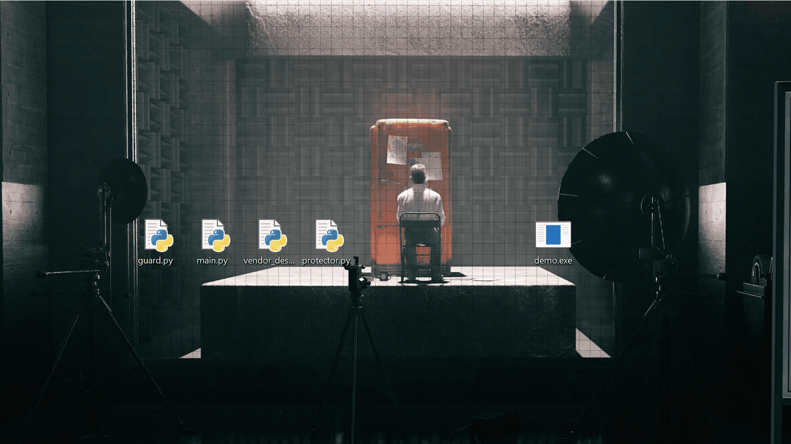

# Karmanti-Armour

**Karmanti** is a licensing and anti-dump armour for Windows applications.
A binary protector that turns a normal `.exe` (or Python script) into a licensed,
zero-disk, dump-resistant executable — without a kernel driver, without a
server, and without leaving the payload on disk.


**[Download the evaluation build](https://github.com/xd4rch/Karmanti-Armour/releases/tag/eval-7.4.6.0)**  
Windows x64 · 1.2 MB · 14 days · no licence key · unsigned · tamper-terminal

> [!NOTE]
> Karmanti is **not** a kernel driver, a hypervisor or a sandbox. It runs in user
> mode, needs no service or driver installation, and makes **no network calls** —
> everything, including licence verification, is offline.

```
your-app.exe  ──►  app.krm  +  app_native.exe  ──►  licence-gated, ADS-hosted, DACL-hardened run
```



> [!TIP]
> **Requirements:** Windows 10/11 x64, and an **NTFS** volume for the zero-disk
> path. On FAT32/exFAT the launcher falls back to a hidden delete-on-close file.
> The generated launcher is a single native `.exe` — no Python runtime needed on
> the customer machine.

---

## What it does

Karmanti takes a finished Windows binary, encrypts it into a `.krm` package and
gives you a **self-contained native launcher**. At run time the launcher
verifies a cryptographic licence, decrypts the payload **in memory**, stages it
into an **NTFS alternate data stream**, launches it suspended, applies a
**kernel DACL** that denies memory-read access to dump tools, and wipes the
staging artefacts when the app exits.

Nothing is written to disk in plain form, and the payload process is not
readable by the same user that launched it.

---

## Feature overview

| Layer | What it does |
|---|---|
| **Packaging** | `KRM3` package: LZNT1-compressed payload + chaotic-stream encryption + 1024-bit Schnorr seal over the vendor public key |
| **Licensing** | 57-character licence keys: Lagrange 2-of-3 hardware binding over GF(999 999 999 989), 1024-bit Schnorr signature, tier + duration + credit metadata, revocable through 16-digit tags |
| **Hardware binding** | Fuzzy HWID from three components (CPU, SMBIOS, disk). Any **two of three** are enough, so a single hardware change does not brick a customer |
| **Zero-disk execution** | Payload runs from a **0-byte `HIDDEN + SYSTEM` carrier** with an ADS stream (`node_xxxxxxxx.dat:s_…exe`); the stream is overwritten and deleted on exit |
| **Anti-dump** | The launcher wipes its **own PE header in RAM**, and locks the child process with a kernel DACL that denies memory-read, memory-write, memory-operation and handle-duplication rights to the interactive user before the first instruction runs |
| **Anti-analysis** | Watchdog thread: debugger detection, known tool-name scan, page-protection checks, DACL weakening detection, hardware breakpoint registers; silent decoy exit instead of a helpful error |
| **Clock protection** | Triple monotonic-clock store (registry + DPAPI state file + NTFS ADS) so rolling the system clock back does not extend a licence |
| **Vendor desk** | Separate seller panel (Python and pure C++ builds) locked to one product ID. Unlocks only with a valid master licence; signing keys are never stored in plaintext |
| **Evaluation builds** | Licence-free, hardware-independent trial launchers with a time + launch limit counted per machine, signed state, and rollback/clock-tamper detection |
| **UX** | The launcher reproduces **Windows' own loader error dialogs** (e.g. a missing DLL) with the original application name, without weakening the protected process |
| **Interface** | Bilingual (Turkish / English) split-view TUI, mouse + keyboard, live status |

---

## How the run-time pipeline works

1. **Locate the licence** — `--license <key>`, a sidecar `<launcher>.lic`, the
   DPAPI vault, or an interactive licence entry (or the evaluation gate).
2. **Verify** — 1024-bit Schnorr signature, 2-of-3 hardware interpolation,
   duration/credit metadata, revocation tags, monotonic clock.
3. **Decrypt** — payload is decompressed and decrypted **in memory**; the
   buffer is zeroed after staging.
4. **Stage** — the image is written into an **ADS stream** on a 0-byte carrier
   file (`node_<random>.dat:s_<random>.exe`, `HIDDEN | SYSTEM`). If the volume
   does not support named streams, a hidden delete-on-close file is used
   instead — **never** a plain copy on NTFS.
5. **Launch suspended** — `CreateProcess(CREATE_SUSPENDED)`.
6. **Harden** — kernel DACL is applied to the child *before* it executes a
   single instruction, then the thread is resumed.
7. **Supervise** — the launcher waits, runs the anti-analysis watchdog, and
   passes the child's exit code through.
8. **Destroy** — the ADS stream is overwritten with zeros, the carrier and
   stream are deleted, handles are closed.

---

## Quick start

The example below is a self-contained program that **measures** the protection of
its own process. Run it unprotected and it reports `UNPROTECTED`; wrap the very
same binary with Karmanti and it reports `PROTECTED` — no source change.

```bash
zig c++ -O2 -std=c++17 runtime_attestation.cpp -o runtime_attestation.exe
runtime_attestation.exe --json --no-wait
```

```jsonc
// before packaging
{"verdict":"UNPROTECTED","ads":false,"self_vm_read_denied":false, ...}

// after packaging (run app_native.exe)
{"verdict":"PROTECTED","ads":true,"carrier_zero":true,"self_vm_read_denied":true, ...}
```

Full instructions: [`examples/README.md`](examples/README.md).

> [!IMPORTANT]
> A protected build is **bound to the machine it was licensed for**. There is no
> universal trial binary in this repository: evaluation builds are generated per
> machine and per product ID. See [Evaluation](#evaluation) and
> [Downloads](#downloads).

---

## Downloads

| Channel | Source | Notes |
|---|---|---|
| Documentation + source example | this repository (`main`) | current |
| Evaluation build | [request one](#evaluation) | built for your machine, time-limited |
| **Evaluation build (demo)** | [Download eval-7.4.6.0](https://github.com/xd4rch/Karmanti-Armour/releases/tag/eval-7.4.6.0) | unsigned, Windows x64, 14 days, tamper-terminal |
| CI status | [Actions](https://github.com/xd4rch/Karmanti-Armour/actions) | a guard job rejects binaries, packages, licence material and broken links |

> [!NOTE]
> This repository intentionally contains **no executables**. Shipping binaries
> through git history is what makes a repository unrecoverable after a leak, so
> a CI job fails the build if `.exe`, `.dll`, `.krm`, `.lic` or archive files are
> ever committed. Distributable builds belong in GitHub Releases.

---

## Documentation

| Document | Contents |
|---|---|
| [docs/architecture_specification.md](docs/architecture_specification.md) | cryptographic primitives, Lagrange 2/3 hardware attestation, chaotic day-ladder |
| [docs/ntfs_ads_execution.md](docs/ntfs_ads_execution.md) | ADS staging workflow, .NET device-path handling |
| [docs/anti_analysis_defense.md](docs/anti_analysis_defense.md) | in-memory header erasure, kernel DACL, anti-dump watchdog |
| [docs/verification_suite.md](docs/verification_suite.md) | test matrix and measured results |
| [docs/seller_certificates.md](docs/seller_certificates.md) | factory certificate verification at the seller desk, signed ceilings, `require_tpm_bind` |
| [docs/revocation.md](docs/revocation.md) | revocation tags, runtime blacklist file, desk commands and limits |

---

## Evaluation

A ready-made evaluation build for the bundled demo payload is published in
[Releases](https://github.com/xd4rch/Karmanti-Armour/releases). For **your own**
application, an evaluation build is generated per machine: a licence-free launcher
that starts a trial on first launch.
An **evaluation build** is a working launcher that:

- needs **no licence key** and runs on **any machine**,
- starts a trial on its first launch: **14 days** and a fixed number of launches,
  counted per machine (a rebuild does not reset it),
- keeps the full protection chain: ADS staging, kernel DACL, payload wipe,
- stores its trial state in three redundant, HMAC-signed locations, and treats
  tampering as terminal: editing the state, rolling the clock back, freezing time
  or restoring a machine snapshot **permanently disables the build** instead of
  merely refusing the run.
Licensed builds (as opposed to this evaluation build) are issued from a **fixed
pool of one-time signing keys**: the factory pre-authorises a number of licences,
each one consumes exactly one key, and when the pool is empty the next licence
cannot be produced at all — the key material for it does not exist.

To get one, open an issue or write to the address in
[SECURITY.md](SECURITY.md) with:

1. the product name and the target `.exe`,
2. the machine's hardware ID (a protected build prints it before asking for a
   key; the example above prints the same format),
3. the tier and duration you want to evaluate.

> [!TIP]
> Trying Karmanti costs nothing but a rebuild: if you only want to see what the
> tooling reports, build [`examples/runtime_attestation.cpp`](examples/runtime_attestation.cpp)
> and compare the `UNPROTECTED` output with the recording above.

---

## What Karmanti is *not*

- It is **not** a kernel driver, hypervisor or sandbox: a determined attacker
  with kernel privileges or physical access can always observe a running
  process. Anti-dump raises the cost substantially; it does not make dumping
  mathematically impossible.
- It is **not** media DRM and it does **not** phone home — everything is offline.
- It does **not** obscure the source of open-source components you ship; it
  protects the *distribution* of your build.

---

## Notes

- .NET payloads are launched through an extended-length (`\\?\`) device path so
  the framework's managed error dialogs keep working from the ADS location.
- The launcher is bilingual; the language is fixed at packaging time.
- Version information (company, product, file description, version) is embedded
  into every generated launcher, so Explorer, SmartScreen and enterprise
  inventory tools see a normal application rather than an anonymous blob.

---

## Antivirus, SmartScreen and false positives

Karmanti *is* a protector. A generated launcher carries an encrypted payload,
decrypts it in memory, writes it into an alternate data stream, creates a
process from that stream and then hardens the running process. Those are the
same behaviours malware packs use, so **unsigned builds are regularly flagged by
heuristic engines**. The verdict is about the *technique*, not about your app.

Microsoft Defender machine-learning detections commonly seen on protected
builds (the `!ml` suffix means "machine-learning heuristic"; the name varies by
engine version):

| Detection name | Heuristic class |
|---|---|
| `Trojan:Win32/Bearfoos.A!ml` | packer / loader heuristics on the launcher |
| `Trojan:Win32/Wacatac.B!ml` | high-entropy embedded payload |
| `Trojan:Win32/Wacapew.C!ml` | unsigned stub carrying an encrypted blob |
| `Program:Win32/Wacapew.A!ml` | self-extracting / installer pattern |

Names and the exact mapping change with every engine version — treat this list
as illustrative, not as a contract.

> [!CAUTION]
> These are **false positives** produced by ML heuristics, but you should still
> treat every report as a signal: scan with a second engine, and make sure the
> payload you packaged is your own signed application. Karmanti contains no
> persistence, no network code and no malicious functionality.

### What to do (in this order)

1. **Code-sign your builds.** A code-signing certificate (signtool + RFC 3161
   timestamp) on the *launcher* removes the "Unknown publisher" wall and part of
   the ML noise. It does **not** make heuristics disappear — ML verdicts key on
   the exact binary, so newly built files can be flagged again.
2. **Report the exact file to Microsoft.**
   <https://www.microsoft.com/en-us/wdsi/filesubmission> → *Software developer* →
   upload the flagged launcher, choose "I believe this is incorrectly detected".
   Include the SHA-256 and a one-line explanation ("commercial licence protector;
   payload is the customer's own application").
3. **Verify before shipping.** Upload to <https://www.virustotal.com> — if only
   Defender/ML engines report it, it is the usual heuristic; if *many* engines
   report it, investigate the payload itself.
4. **If you ship to many customers**, join the **Microsoft Virus Initiative
   (MVI)** — it gives ongoing whitelisting instead of one-off reports.
5. **Customer-side, if needed:** Windows Security → *Protection history* →
   *Allow on device*, or add an exclusion for the application folder. Never tell
   users to turn Defender off globally.

### Reducing heuristic noise

- Embed a full version-info resource (CompanyName, ProductName, FileDescription,
  FileVersion) and a real icon; generated launchers already carry both.
- Do **not** pack the launcher with UPX or similar; Karmanti does not.
- Sign *after* packaging and **re-submit after significant rebuilds** — ML
  signatures key on the exact binary, so every new build can be flagged again.
- Keep the embedded payload compressed, not raw — a raw high-entropy blob next
  to a launcher is the single strongest ML trigger.

### Certificate options (as of 2026)

| Option | Cost | Notes |
|---|---|---|
| No signature | 0 | Strong SmartScreen warning; users must choose "Run anyway" |
| Self-signed | 0 | Blocked for public distribution; dev / managed fleets only |
| Azure Artifact Signing (formerly Trusted Signing) | ~$9.99/month | Individuals: US/Canada only. Organisations: US/CA/EU/UK |
| OV certificate (DigiCert, Sectigo, Certum, …) | $150–300/year | Worldwide, hardware token/HSM required |
| EV certificate | $400+/year | **No longer bypasses SmartScreen** (changed in 2024) |

\* The launcher is fully offline: no telemetry, no network calls, no persistence.

---

## Contributing

This repository holds **documentation and one source example**. Fixes to typos,
broken links and the example are welcome — open an issue or a pull request that
touches only those files. The protector itself is closed-source and is not
developed here; pull requests that add packaging, licensing or anti-dump logic
will be closed.

---

## Legal

Karmanti is a software-protection tool for **your own** applications.
Use it only on binaries you own or are authorised to protect. Do not use it to
conceal malware — the project is intended for licence enforcement and
anti-tamper on legitimate commercial software.

---

## Repository

| Link | What it is |
|---|---|
| <https://github.com/xd4rch/Karmanti-Armour> | canonical repository URL |
| [Releases](https://github.com/xd4rch/Karmanti-Armour/releases) | evaluation builds (`eval-7.4.1.0` current, `eval-7.4.0.0` previous) |
| [Docs](https://github.com/xd4rch/Karmanti-Armour/tree/main/docs) | architecture, ADS execution, anti-dump, verification |
| [examples/](examples/) | the source example (`MIT`) and its build instructions |
| [LICENSE](LICENSE) | documentation and brand terms; the example is MIT |
| [SECURITY.md](SECURITY.md) | private vulnerability / leak reporting |
| [CHANGELOG.md](CHANGELOG.md) | version history of this documentation set |
| <https://github.com/xd4rch> | maintainer profile |

This repository contains **documentation and a source example only**. It ships
no binaries, no sealed packages and no licence material; a CI check rejects
those. The protector itself is distributed commercially and per product ID.

## Support

If this work is useful to you and you want to support it, you can send SOL or any
SPL token on Solana to:

```
2Sev9nLFVc9CHikPfPEPnsZenu4NL8twtCchiNVEeg8h
```

Donations are voluntary and do not buy a licence, a support contract or any
priority. For licensing, use the contact address above.
